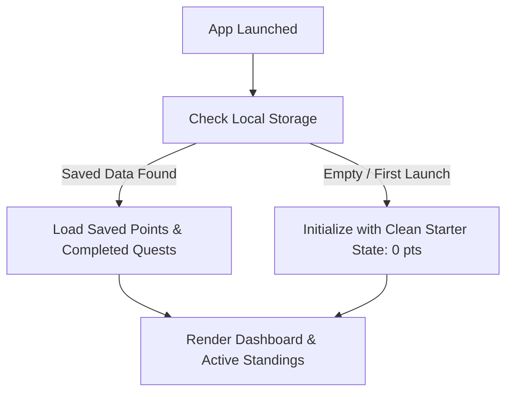

# EcoQuest — Phase 2: Application Design & Requirements Specification

> **Project Name:** EcoQuest — Gamified App for Sustainability  
> **Platform:** Android (React Native via Expo)  
> **Target Audience:** College Presentation & Live Demonstration  
> **Design Theme:** Fresh Emerald Eco Palette (Green & White, Clean Card UI)  
> **Architectural Principle:** Client-Side Architecture (No server/backend required, zero paid tools)  

---

## 1. Executive Summary & Architecture Overview

EcoQuest is an interactive, gamified mobile application designed to promote everyday sustainable behaviors among college students. Users complete micro-challenges (such as conserving electricity, reducing plastic waste, and using sustainable transport), earn Eco Points, unlock achievement badges, and climb a collegiate leaderboard.

To ensure stability, simplicity, and zero maintenance during presentation:
- **Zero Backend Dependency:** All challenge data, badge definitions, and leaderboard rankings run entirely within the mobile client.
- **Local Persistence:** Demonstrator progress (points, completed challenges, and badges) is saved to the phone's local storage (`AsyncStorage`) so progress is not lost if the app is refreshed or closed.
- **Demo Reset Function:** A one-tap "Reset Demonstration" button allows the presenter to clear all progress back to a pristine starter state before starting a live presentation.

---

## 2. Screen Specifications & Features

EcoQuest consists of **5 core screens**, each serving a focused role:

```
┌────────────────────────────────────────────────────────┐
│                      ECOQUEST APP                      │
├─────────────┬─────────────┬─────────────┬─────────────┬┤
│  Dashboard  │ Challenges  │ Leaderboard │   Badges    ││
│   (Home)    │  (Quests)   │ (Podium)    │ (Trophies)  ││
└─────────────┴─────────────┴─────────────┴─────────────┴┘
```

### 1. Dashboard Screen (Home)
- **Header Profile Card:** 
  - Displays user avatar, name (*"Aditya — Eco Explorer"*), and current Level (starts at *Level 1: Eco Seedling*).
  - Visual Level Progress Bar showing points required for next level.
- **Impact Metrics Grid (Key Performance Cards):**
  - **Total Eco Points:** Large numeric highlight (starts at `0 pts`; increments dynamically as challenges are completed).
  - **Quests Completed:** Count of finished actions (starts at `0 completed`).
  - **Badges Earned:** Trophies unlocked (starts at `0 / 8 badges`).
  - **Illustrative CO₂ Estimate (Educational Display):** Clearly labeled as an *illustrative educational estimate* (using a simple rule of thumb: ~0.05 kg CO₂e per point earned, starting at `0.0 kg CO₂e`) rather than a certified or measured environmental impact. If preferred during final review, this card can be toggled to a "Sustainability Streak" to keep all metrics strictly verifiable.
- **Eco Tip of the Day:** A rotating, inspiring sustainability tip (e.g., *"Unplugging idle chargers saves up to 10% on household electricity!"*).
- **Featured Daily Quest:** A quick-access challenge card with an instant **"Mark Complete"** button.

### 2. Sustainability Challenges Screen (Quests)
- **Category Filter Bar:** Horizontal pill buttons to filter challenges:
  - `All` | `⚡ Energy` | `♻️ Waste` | `💧 Water` | `🚲 Transport` | `🥗 Food`
- **Challenge Cards:**
  - **Title & Description:** Clear, student-friendly actionable micro-tasks.
  - **Category Tag & Impact Badge:** Visual tag (e.g., *Waste* • *Medium Impact*).
  - **Point Value:** Prominent reward pill (e.g., `+30 pts`).
  - **Completion State:**
    - *Available:* Active green button `[ Mark as Done ✓ ]`.
    - *Completed:* Disabled light-mint button with checkmark `[ Completed ✓ ]`.

### 3. Rewards & Badges Screen (Achievements)
- **Achievement Summary:** Summary header showing total badges unlocked (starts at `Total Badges: 0 / 8 Unlocked`; updates dynamically as badges are earned).
- **Badge Grid (2-column card layout):**
  - **Unlocked Badges:** Vibrant green/gold theme, illuminated badge icon, unlock title, and date earned.
  - **Locked Badges:** Semi-transparent / grayscale styling, padlock icon, and progress requirement text (e.g., *"Earn 250 points to unlock"*).

### 4. Leaderboard Screen (Campus Standings)
- **Podium Visual (Top 3):**
  - Gold (#1), Silver (#2), and Bronze (#3) pedestals with avatars, student names, and high scores.
- **College Ranking List:**
  - Scrollable list of fictional peers (e.g., Aarav P., Maya S., Rohan K., Priya D.).
  - Shows Rank #, Avatar, Name, Department/Campus tag, and Total Points.
- **Live User Rank Banner (Sticky Bottom Bar):**
  - Highlights the demonstrator's dynamic rank calculated directly from their actual current score (starts at *"Your Standing: Rank #8 • 0 pts"*; climbs dynamically as quests are completed).
  - **Live Presentation Dynamic:** As the user marks challenges complete on the presentation phone, their rank automatically climbs up the leaderboard in real time!

### 5. Profile & Demonstration Settings Screen
- **User Identity:** Avatar, display title, and presentation badge.
- **Total Lifetime Stats:** Detailed summary of sustainable accomplishments.
- **Recent Activity Log:** Chronological list of completed quests with timestamps.
- **Demonstration Controls (Essential for College Demo):**
  - **Reset Demo Data Button:** Clear all completed challenges and points with a confirmation modal so the presenter can test repeatedly.
  - **App Information:** Version `1.0.0`, Expo SDK `57`, College Project metadata.

---

## 3. Navigation Design

To guarantee zero setup failures, maximum stability, and lightning-fast transitions:
- **Navigation Type:** Fixed Bottom Navigation Bar.
- **5 Navigation Tabs:**
  1. `🏠 Home` — Overview and daily snapshot.
  2. `🎯 Quests` — Full challenge catalog.
  3. `🏆 Rank` — Campus leaderboard.
  4. `🎖️ Badges` — Unlocked achievements.
  5. `👤 Profile` — Stats, logs, and reset switch.
- **Architecture:** State-based active screen routing rendered through a single root component with zero extra native routing configuration required.

---

## 4. Challenge Catalog & Point System

### Pre-configured College Challenges

| ID | Title | Category | Impact | Points | Description |
|:---|:---|:---|:---|:---:|:---|
| `ch-1` | Reusable Water Bottle | ♻️ Waste | Medium | **+30** | Carried a refillable water bottle instead of purchasing single-use plastic bottles. |
| `ch-2` | Lights & Fans Off | ⚡ Energy | Low | **+20** | Switched off lights and classroom fans when vacating the room. |
| `ch-3` | Green Commute | 🚲 Transport | High | **+40** | Walked, cycled, or used public transit instead of a personal motor vehicle. |
| `ch-4` | Plant-Based Meal | 🥗 Food | Medium | **+25** | Chose a vegetarian or plant-forward meal for lunch today. |
| `ch-5` | Segregate Campus Waste | ♻️ Waste | Medium | **+35** | Properly separated wet organic waste and dry recyclables into separate bins. |
| `ch-6` | 5-Minute Shower | 💧 Water | Medium | **+25** | Conserved water by limiting shower time to under five minutes. |
| `ch-7` | Unplug Idle Chargers | ⚡ Energy | Low | **+15** | Disconnected phantom power chargers and adapters when not actively charging devices. |
| `ch-8` | Bring a Tote Bag | ♻️ Waste | Low | **+20** | Used a reusable cloth bag for groceries or supplies instead of polythene bags. |

---

## 5. Gamification Rules: Points & Badges

### Point Calculation Rules
1. Every challenge has a fixed, non-negative integer point value ($15$ to $40$ pts).
2. **Duplicate Prevention Rule:**
   - Once a challenge with `id` is marked completed, its ID is appended to `completedChallengeIds: []`.
   - The UI immediately disables the button and updates the state.
   - The action handler checks:
     $$\text{if } id \in \text{completedChallengeIds} \implies \text{Ignore action}$$
   - This prevents double-awarding of points under any circumstance.

### Leveling Hierarchy
- **Level 1 (Eco Seedling):** $0 - 99$ points
- **Level 2 (Green Scout):** $100 - 249$ points
- **Level 3 (Earth Guardian):** $250 - 449$ points
- **Level 4 (Planet Champion):** $450+$ points

### Badge Unlock Definitions

| Badge ID | Badge Title | Icon | Condition to Unlock | Description |
|:---|:---|:---:|:---|:---|
| `bdg-first` | Eco Starter | 🌱 | 1 challenge completed | Awarded for taking your very first step toward sustainability. |
| `bdg-100` | Green Sprout | 🌿 | $\ge 100$ total points | Earned your first 100 Eco Points. |
| `bdg-250` | Earth Guardian | 🛡️ | $\ge 250$ total points | Reached 250 points and Level 3 milestone. |
| `bdg-500` | Planet Hero | 🌎 | $\ge 500$ total points | Master sustainability level attained. |
| `bdg-waste` | Zero-Waste Pioneer | ♻️ | 2 Waste challenges done | Demonstrated outstanding commitment to reducing single-use waste. |
| `bdg-energy` | Watts Saver | ⚡ | 2 Energy challenges done | Significant reduction in electricity and standby power. |
| `bdg-commute` | Clean Cruiser | 🚲 | 1 Transport challenge done | Reduced campus transit carbon emissions. |
| `bdg-water` | Hydro Guardian | 💧 | 1 Water challenge done | Conserved campus water resources through efficient daily usage. |

---

## 6. Simulated Leaderboard (Dynamic Campus Standings)

The leaderboard contains realistic fictional students from the campus:

```
1. 🥇 Maya Sharma      (Dept. of Computer Science)    — 340 pts
2. 🥈 Aarav Patel       (Dept. of Environmental Eng.)  — 290 pts
3. 🥉 Priya Nair        (Dept. of Architecture)        — 210 pts
4.    Rohan Das         (Dept. of Mechanical Eng.)     — 160 pts
5.    Zara Khan         (Dept. of Biotechnology)       — 120 pts
6.    Vikram Rao        (Dept. of Civil Engineering)   — 75 pts
7.    Neha Gupta        (Dept. of Chemical Eng.)       — 40 pts
8.    Aditya (You)      (College Demo Account)         — 0 pts  <-- Calculated from actual live score!
```

- **Baseline Score:** The demonstrator starts cleanly at `0 pts` (Rank #8).
- **Dynamic Rank Calculation:** The leaderboard does not hardcode the user's score or rank. Instead, it dynamically inserts the demonstrator's actual live point total into the standings, sorts all entries descending by points, and determines the user's current rank in real time.
- **Live Presentation Dynamic:** As the presenter marks challenges complete during the demonstration, their points increase from 0 and their card visibly climbs up the leaderboard (e.g., completing a 40 pt quest moves them to Rank #7; completing another 35 pt quest moves them to Rank #6), creating an engaging live demo moment!

---

## 7. Data Storage & Reset Flow

### Storage Keys
- `ECOQUEST_POINTS`: Numeric integer (starts at `0`).
- `ECOQUEST_COMPLETED_IDS`: JSON array of completed challenge strings (e.g., `["ch-1", "ch-2"]`).
- `ECOQUEST_BADGES`: JSON array of unlocked badge IDs (e.g., `["bdg-first", "bdg-waste"]`).

### State Initialization Flow


### Reset Demo Flow
1. User navigates to **Profile** screen.
2. Taps red **"Reset Demonstration Data"** button.
3. System shows confirmation alert: *"Reset all progress to 0 for a fresh presentation?"*
4. Upon confirmation:
   - Clears stored keys in local storage.
   - Resets state back to 0 points, empty completed list, and default Level 1.
   - Shows feedback toast: *"Demo data reset successfully."*

---

## 8. Visual Design System

- **Primary Brand Color:** `#10B981` (Vibrant Emerald Green)
- **Dark Accent:** `#064E3B` (Deep Forest Green)
- **Background Tint:** `#F0FDF4` (Fresh Mint Tint)
- **Card Background:** `#FFFFFF` (Crisp Pure White)
- **Secondary Surfaces:** `#F8FAFC` (Soft Slate Gray)
- **Border Lines:** `#E2E8F0` (Subtle Divider Gray)
- **Typography Colors:**
  - Headings: `#0F172A` (Slate 900)
  - Body Text: `#334155` (Slate 700)
  - Captions/Muted: `#64748B` (Slate 500)
- **Accents:**
  - Trophy Gold: `#F59E0B`
  - High Impact Tag: `#EF4444`
  - Medium Impact Tag: `#F59E0B`
  - Low Impact Tag: `#3B82F6`

---

## 9. Comprehensive Testing & Verification Plan

| # | Test Scenario | Expected Outcome | Verification Method |
|:---:|:---|:---|:---|
| **T1** | App Startup & Navigation | App boots to Dashboard; bottom tabs switch between all 5 screens smoothly with active tab highlight. | Manual tap through all 5 tabs in Expo Go. |
| **T2** | Quest Category Filter | Tapping category pills filters challenge cards accurately (e.g., only Energy quests appear). | Tap filter pills and check displayed cards. |
| **T3** | Challenge Completion | Tapping "Mark as Done" adds points to balance, increments completed count, and changes button to disabled "Completed ✓". | Tap button; observe points increase instantly. |
| **T4** | Duplicate Reward Prevention | Tapping a completed challenge button does nothing; points do not increase further. | Attempt multiple taps on finished card. |
| **T5** | Badge Auto-Unlock | Completing 1st challenge triggers "Eco Starter" badge unlock modal/notification. Reaching 100 pts unlocks "Green Sprout". | Complete challenges until threshold is crossed; inspect Badges tab. |
| **T6** | Dynamic Leaderboard | User starts at Rank #8 with 0 pts. When challenges are completed, user's live score updates and user's rank climbs up the leaderboard in real time. | Complete quests and verify rank position shift. |
| **T7** | Data Persistence | Close app completely and relaunch in Expo Go; previously earned points and completed challenges remain intact. | Force-close Expo Go, reopen app, verify points match. |
| **T8** | Demo Reset | Tapping "Reset Demonstration Data" resets points to 0, locks badges, and restores all quest buttons to active. | Tap reset in Profile and confirm state returns to zero. |

---

## 10. Next Steps

Upon your review and approval of this plan:
1. We will implement the modular application components in Phase 3.
2. We will test all 8 verification scenarios on your Android phone via Expo Go.
3. We will package clean presentation notes for your college demonstration.
